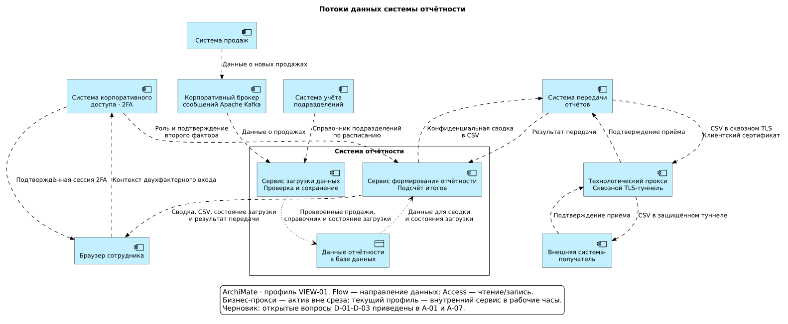
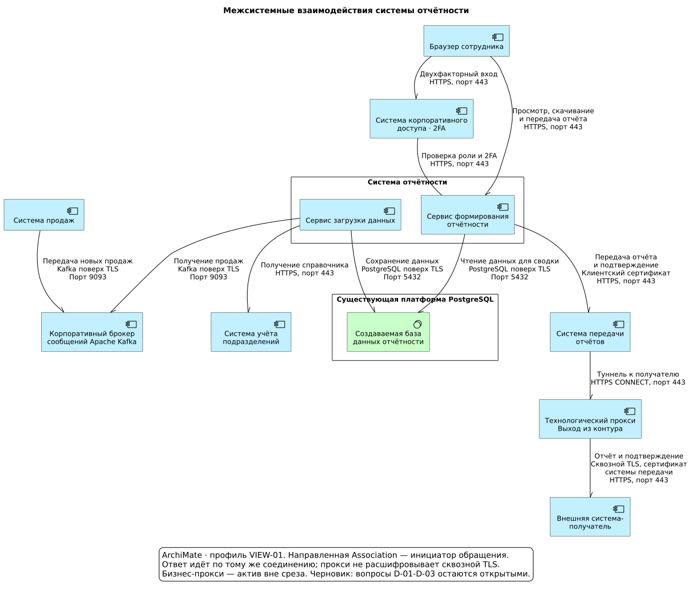

# Ожидаемый результат для системы отчётности

Эталон подготовлен по [синтетическому BRD и корпоративному контексту](../reporting-system.md). Решения предложены для ревью; согласование и ответы человека не имитируются. Для чтения достаточно этого документа и входного BRD; [YAML-манифест](manifest.yaml) — редактируемое приложение.

## Анализ требований — A-01

Проектируются два сервиса: загрузка данных и формирование отчётности. Внешние системы и платформы переиспользуются. Пользователь — сотрудник с ролью «Аналитик».

| Требование | Подтверждающий фрагмент BRD | Где учтено |
| --- | --- | --- |
| R-01 | «Получать новые продажи в течение дня» | Поток через брокер в загрузчик |
| R-02 | «Получать полный справочник подразделений каждый день в 06:00» | Обращение загрузчика к системе учёта подразделений |
| R-03 | «Повтор сообщения с тем же номером продажи не создаёт дубль» | Проверка номера и сохранение в БД |
| R-04 | «видит подразделения с продажами» | Чтение данных и подсчёт итогов |
| R-05 | «Файл рассчитывается на момент запроса» | Формирование CSV сервисом отчётности |
| R-06 | «состояние загрузки и время последней успешной обработки» | Служебные сведения в БД и пользовательском ответе |
| N-01 | «не более 5 секунд» | Целевой показатель; требует испытаний |
| N-02 | «Целевое восстановление — до 4 часов» | Платформа БД и будущие эксплуатационные проверки |
| N-03 | «Каждый пользовательский запрос разрешён» | Обращение к системе корпоративного доступа |

## Архитектура данных — A-02, A-03

Все наборы относятся к внутренним данным компании.

| Набор | Кто предоставляет или формирует | Хранение |
| --- | --- | --- |
| Данные о продажах | Система продаж | Через брокер поступают в БД отчётности |
| Справочник подразделений | Система учёта подразделений | Копия в БД отчётности |
| Данные отчётности | Сервис загрузки данных | Продажи за 30 дней, справочник и состояние загрузки в БД |
| Сводный отчёт | Сервис формирования отчётности | Не сохраняется; выдаётся сотруднику |
| Состояние загрузки | Сервис загрузки данных | Служебные сведения в БД отчётности |
| Результат проверки доступа | Система корпоративного доступа | Не сохраняется |

| Откуда | Куда | Какие данные | Когда |
| --- | --- | --- | --- |
| Система продаж | Корпоративный брокер сообщений | Новая продажа | После завершения продажи |
| Корпоративный брокер сообщений | Сервис загрузки данных | Данные о продажах | В течение дня |
| Система учёта подразделений | Сервис загрузки данных | Справочник подразделений | При запуске и ежедневно в 06:00 |
| Сервис загрузки данных | Данные отчётности в БД | Проверенные продажи, справочник и состояние загрузки | После обработки входных данных |
| Данные отчётности в БД | Сервис формирования отчётности | Продажи, подразделения и состояние загрузки | При пользовательском запросе |
| Система корпоративного доступа | Сервис формирования отчётности | Результат проверки прав | При каждом пользовательском запросе |
| Сервис формирования отчётности | Браузер сотрудника | Сводка, CSV и состояние загрузки | После проверки доступа |

Загрузчик проверяет продажи и сохраняет их без повторов. Сервис отчётности связывает продажи с наименованиями подразделений, группирует их и подсчитывает количество и сумму. Эти преобразования и чтение/запись БД показаны на уровне назначения сервисов; внутренние алгоритмы и таблицы БД не раскрываются.

## Межсистемные взаимодействия — A-04, A-05

Создаются только сервис загрузки данных и сервис формирования отчётности. Остальные системы и платформы уже существуют.

| Инициатор | Получатель | Назначение обращения | Протокол | Порт |
| --- | --- | --- | --- | --- |
| Система продаж | Корпоративный брокер сообщений | Публикация новых продаж | Kafka поверх TLS | 9093 |
| Сервис загрузки данных | Корпоративный брокер сообщений | Чтение продаж | Kafka поверх TLS | 9093 |
| Сервис загрузки данных | Система учёта подразделений | Получение справочника | HTTPS | 443 |
| Сервис загрузки данных | База данных отчётности | Сохранение данных и состояния загрузки | PostgreSQL поверх TLS | 5432 |
| Сервис формирования отчётности | База данных отчётности | Чтение данных для сводки и состояния загрузки | PostgreSQL поверх TLS | 5432 |
| Сервис формирования отчётности | Система корпоративного доступа | Проверка прав сотрудника | HTTPS | 443 |
| Браузер сотрудника | Сервис формирования отчётности | Просмотр сводки и состояния загрузки, скачивание CSV | HTTPS | 443 |

Загрузчик инициирует чтение из брокера, хотя сами данные идут из брокера в загрузчик. Аналогично, запрос справочника направлен к системе учёта подразделений, а справочник возвращается из неё.

## Архитектурный манифест — A-06

[manifest.yaml](manifest.yaml) содержит контекст, понятные названия и назначения систем, описание данных, потоки и технические обращения. Ключи связей осмысленные; служебные номера на диаграммах не показываются. Реестр требований и результаты проверок остаются в этом документе.

## Решения — часть A-07

| Предложение и причина | Существенная альтернатива | Авторитетный источник |
| --- | --- | --- |
| Отделить загрузчик от пользовательского сервиса: продажи поступают в рабочее время | Совместить обработку и пользовательские запросы; противоречит правилу разделения | R-01, ARCH-02 |
| Получать продажи через готовый Kafka, а справочник — по расписанию | Периодически запрашивать продажи по HTTP; такого интерфейса во вводных нет | R-01, R-02; каталог систем |
| Сохранять данные в готовой PostgreSQL и учитывать номер продажи перед подтверждением сообщения | Формировать отчёт прямо из источников; не даёт собственного накопленного набора и защиты от повторов | R-03, R-06, ARCH-01 |
| Проверять права через готовую систему корпоративного доступа | Создать собственную систему доступа; вводные этого не требуют | N-03, SEC-02 |

## Отчёт проверок — часть A-07

Документы и манифест проверяются в рамках одного коммита Git.

| Что проверено | По какому источнику | Результат |
| --- | --- | --- |
| Ссылки YAML, названия, таблицы и исходники диаграмм согласованы | Структура модели | Пройдено при подготовке эталона |
| Направления данных и технических обращений разделены; загрузчик выделен | R-01, ARCH-02, VIEW-01 | Пройдено |
| Протоколы защищены; порты соответствуют заданному каталогу | SEC-01 | Пройдено |
| Права доступа, защита от дублей и сохранность сообщений предусмотрены | R-03, R-06, SEC-02, SEC-03 | Учтено в проекте; выполнение требует тестов реализации |
| Типы элементов и связей соответствуют выбранному профилю | VIEW-01 | Пройдено для этого профиля |
| Задержка данных, время ответа, доступность и восстановление достигнуты | R-01, N-01, N-02 | Не проверено: нужны эксплуатационные испытания |

Полная нормативная проверка ArchiMate и согласование человеком остаются открытыми. Структурная проверка эталона не доказывает работоспособность будущей реализации.
