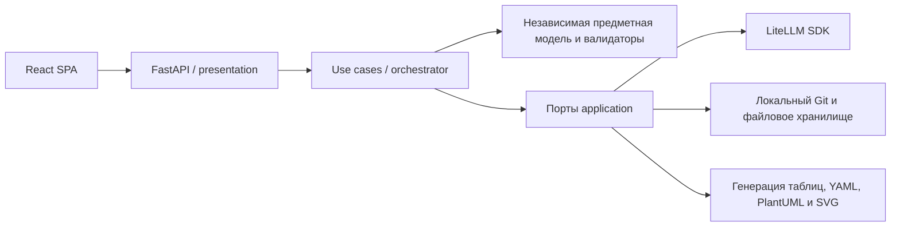

# Техническое проектирование SolutionArchitectAI

Статус: рекомендации для ревью перед реализацией, а не утверждение требований или ручного эталона.
Основание — [BRD](../BRD.md), [архитектурные принципы](../architecture.md), [согласование](../review.md), [проверочные сценарии](../verification-scenarios.md) и [ручной пример](../examples/reporting-system.md).
Исследование официальной документации выполнено 10 ноября 2026 года; ссылки приведены рядом с решениями в тематических документах.
Точные версии выбираются и фиксируются lock-файлами в PR исполняемого каркаса после проверки совместимости, а не назначаются здесь произвольно.

## Рекомендуемая архитектура

Отдельная React SPA и модульный Python backend. Предметная модель независима от HTTP, LLM, YAML и PlantUML.
Агенты предлагают изменения через application-контракты; детерминированные проверки и явные действия архитектора управляют применением и согласованием.
Модель, A-01–A-07, источники и решения сохраняются снимками в локальном Git проекта; незавершённый ввод и выполнение операций хранятся отдельно.
Пользователь работает через чат, структурированные редакторы, просмотр артефактов и историю; команды Git ему не требуются.

Стрелки показывают вызовы во время выполнения; правила импортов определены в [backend.md](backend.md).
HTTP API и CLI используют одни use cases; CLI — возможная точка входа, не дополнительное обязательное приложение MVP.

| Область | Рекомендация | Где обоснована |
| --- | --- | --- |
| Backend | Python, FastAPI, Pydantic, Dishka; dataclasses в domain | [Backend](backend.md) |
| LLM | LiteLLM SDK за своим портом; собственная последовательная координация | [Сравнение библиотек](backend.md#выбор-llm-библиотеки) |
| Агенты | Общий вход и типизированные результаты предложения/ревью; контроль версии и идемпотентность | [Агенты](agents.md) |
| Frontend | React, TypeScript, Vite, React Router, TanStack Query, Material UI | [Frontend](frontend.md) |
| Настройки | Pydantic Settings, разделённые источники YAML/окружения/секретов | [Конфигурация](configuration.md) |
| Развёртывание | Docker Compose: frontend и backend; рендерер внутри backend | [Развёртывание](deployment.md) |
| Качество | Ruff, Pyright, узкий WPS231; pytest; ESLint, Prettier, Vitest, Playwright | [Качество и тесты](quality-and-testing.md) |
| Реализация | Небольшие PR с наблюдаемыми результатами и критериями готовности | [План](implementation-plan.md) |

## Связь с требованиями и эталоном

| Требование | Техническая опора |
| --- | --- |
| FR-01–FR-05: поэтапное проектирование, вопросы и обоснования | [Контракты и пример операции](agents.md); роли агентов не меняют этапы BRD |
| FR-06, AC-11: одинаковая проверка всех способов ввода | [Преобразование и валидаторы](backend.md#предметная-модель-ввод-и-артефакты) |
| FR-07, FR-09–FR-10: формальные проверки и отдельный judge | [Границы полномочий](agents.md), [сценарии испытаний](quality-and-testing.md) |
| FR-08, AC-16: согласованные A-01–A-07, .puml и SVG | [Проекции модели](backend.md#предметная-модель-ввод-и-артефакты) |
| FR-11, AC-17: коммиты, diff, восстановление, согласование снимка | [Хранение и отказоустойчивость записи](backend.md#хранение-и-запись-в-git) |
| AC-14–AC-15: измерение качества ИИ на синтетике | [Отдельные LLM-испытания](quality-and-testing.md#llm-без-обязательного-внешнего-api) |

В [эталоне результата](../examples/reporting-system/expected-result.md) чтение Kafka инициирует загрузчик, а данные идут из брокера в загрузчик.
Поэтому направления данных, технических вызовов и ответов моделируются отдельно; их нельзя вывести из одной универсальной стрелки.
Kafka, PostgreSQL, 2FA и корпоративные прокси из примера описывают проектируемую систему отчётности: они не становятся инфраструктурными зависимостями самого помощника.

## Открытые решения и границы

| Вопрос | Рекомендация и зависимость |
| --- | --- |
| Q-01, Q-04 из review.md | Утвердить объём MVP и достаточность манифеста на конкретной редакции; этот PR их не закрывает |
| Q-02: интерфейс | Рекомендуется SPA с чатом и редакторами; согласование статического прототипа — следующий PR по [плану](implementation-plan.md) |
| Q-03: перенос в Archi | Обязательность остаётся открытой; при положительном решении до окончательной приёмки нужны Exchange XML и проверка реального импорта |
| Входные форматы | Рекомендуются UTF-8 Markdown/текст для BRD и контекста, YAML для модели; расширение на PDF/DOCX зависит от согласования приёмочного набора |
| LLM и данные | Провайдер, конкретные модели и числовые цели смысловой диагностики выбираются по экспериментам; разрешённые места обработки реальных данных пока не определены |
| Эксплуатация | Локальный однопользовательский MVP; аутентификация удалённого доступа, сроки хранения черновиков и резервирования требуют отдельных требований |

Рекомендуемый MVP обходится без LangChain, LangGraph, Redis, брокера задач, векторной и реляционной БД.
При появлении требования нескольких процессов, пользователей или длительных распределённых задач это решение пересматривается явно.
До продуктовой реализации требуется согласование требований и эталона по [review.md](../review.md); подготовка данного технического предложения не означает такого согласования.
