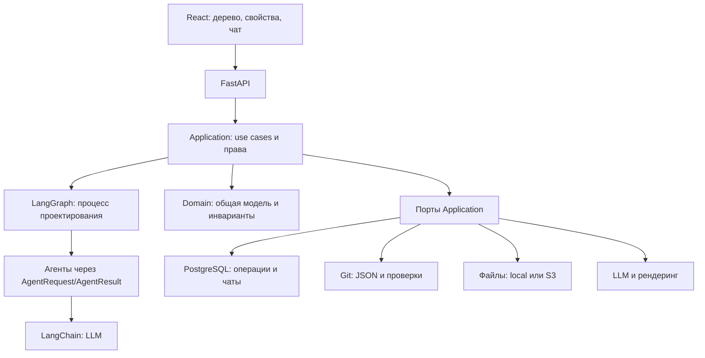

# Техническая архитектура SolutionArchitectAI

Статус: планируемые решения реализации MVP для технического согласования. Выбор стека не означает согласования ручного эталона.
Источники для нового LLM-стека проверены **12 ноября 2026 года**: [ChatOpenAI](https://docs.langchain.com/oss/python/integrations/chat/openai), [LangGraph](https://docs.langchain.com/oss/python/langgraph/graph-api), [PostgreSQL checkpointer](https://github.com/langchain-ai/langgraph/tree/main/libs/checkpoint-postgres) и метаданные PyPI. На дату проверки: langchain-core 1.8.0, langchain-openai 1.7.4, langgraph 1.2.20, langgraph-checkpoint-postgres 3.2.0; эти версии совместимы по заявленным ограничениям зависимостей, но конкретные версии будут закреплены вместе при реализации. Frontend, Python 3.13 и контейнерное развёртывание дополнительно проверены 12 ноября 2026 года. Проверены metadata/peer ranges и разрешение backend-зависимостей для Python 3.13; backend/frontend не реализованы и не испытаны. Версии фиксируются lock-файлами при реализации.

## Общая модель и рабочее место

Одно корпоративное архитектурное пространство имеет один общий архитектурный Git-репозиторий. Каталоги систем, компонентов, данных, интерфейсов, отношений и решений образуют предметную модель с устойчивыми ID. Дерево представлений организует её срезы, а не копии объектов. Изменение общего сервиса влияет на все использующие его представления; расположение, масштаб, группировки и локальные подписи принадлежат конкретному представлению.

Проект группирует задачи и требования. Задача хранит цель, чаты, предложения, затронутые ID и привязку к рабочей ветке. Она не владеет отдельной копией корпоративной архитектуры. `main` содержит согласованную общую модель; под задачу создаётся ветка от точного актуального `main`. Принятие предложения, коммит, архитектурное согласование и merge — разные события.

**`review/base` — основная ветка приложения в этом репозитории. `main` ниже — ветка архитектурного репозитория, которым будет управлять приложение.** Постоянной `dev` нет. ИИ не выполняет merge и не согласовывает собственные предложения. GitLab MR не обязателен для MVP.

Стрелки — вызовы, не импорты. Направления зависимостей и отдельный пакет Persistence описаны в [backend.md](backend.md).

| Область | Решение | Подробности |
| --- | --- | --- |
| Backend | Python 3.13, uv, FastAPI, Dishka, PostgreSQL, SQLAlchemy 2.x, Alembic, Pydantic | [Backend](backend.md) |
| LLM и граф | langchain-core, langchain-openai, Pydantic, StructuredOutputGenerator; LangGraph + PostgreSQL checkpoints для многоэтапного проектирования | [Генерация](structured-output.md), [граф](agent-pipeline.md) |
| Модель | Python Domain Model с валидаторами; JSON для сохранения/восстановления | [Модель и хранение](domain-model.md) |
| Состояние | PostgreSQL / Git / local или S3; журнал и восстановление вместо общей транзакции | [Согласованность](persistence.md#согласованность-хранилищ) |
| Frontend | React, TypeScript, Vite, React Router, TanStack Query; shadcn/ui + Tailwind CSS, assistant-ui, React Flow | [Рабочее место](frontend.md), [выбор библиотек](frontend-library-evaluation.md) |
| Конфигурация | Pydantic Settings, несекретный YAML приложения, environment overrides и secret files | [Настройки](configuration.md) |
| Поставка | Docker Compose: frontend/backend/PostgreSQL/PlantUML Server и durable Git/files; LLM отдельно; будущий production — OpenShift | [Развёртывание](deployment.md) |
| Качество | Ruff, Pyright, pytest, import-linter; TypeScript, Vitest, Playwright | [Проверки](quality-and-testing.md) |
| Следующий результат | Ранний React → FastAPI → LangChain → локальная LLM с сохранённым чатом; затем первый LangGraph HITL-сценарий | [План](implementation-plan.md) |

## Что взято из Archi

Archi в среде не обнаружен; установки и практического испытания не было. Изучено [официальное руководство Archi 5.11](https://www.archimatetool.com/downloads/archi/Archi%20User%20Guide.pdf): разделы Model Tree, Concepts in the Model Tree and Views, Views, Viewpoints, Properties, Navigator. Выводы для нашей модели:

| Концепция Archi | Следствие для SolutionArchitectAI |
| --- | --- |
| Model Tree, Elements, Relationships | Каталог общих объектов и отношений, независимый от диаграмм; логические папки для навигации |
| Views | Несколько отображений одного объекта по ID; удаление из вида не равно удалению из модели |
| Viewpoints | Цель и допустимый состав представления; VIEW-01 примера — конкретный профиль, не полное покрытие ArchiMate |
| Properties | Семантические свойства объекта отделены от оформления его экземпляра в виде |
| Navigator и ссылки на виды | По объекту доступны отношения и список использующих его представлений; поиск в дереве |

Повторное использование общей идентичности — обязательное свойство. Не требуется одна гигантская диаграмма или визуальный редактор уровня Archi. Exchange XML остаётся отдельным открытым экспортом, не внутренним форматом и не обязательством MVP.

## Связь с требованиями и границы

FR-01–FR-05 поддерживают [роли и граф проектирования](agents.md); FR-06/08 — общую модель и её проекции; FR-07/09/10 — независимые проверки и выделение сомнительных предложений ИИ; FR-11 — [ветки, историю и согласование](git-workflow.md). BRD и синтетический пример описывают пользовательские требования и эталон; этот пересмотр меняет только технический способ реализации.

Kafka, 2FA и прокси синтетической системы отчётности не становятся зависимостями помощника. PostgreSQL помощника нужен для его операционного состояния независимо от PostgreSQL в примере.

Открыты предметное согласование полного эталона, обязательность XML-обмена, поддерживаемые входные форматы сверх Markdown/текста, модели и цели смыслового качества. Реальные закрытые данные, удалённый доступ и эксплуатация в конкретной организации не разрешаются этим проектированием.

Краткий обзор для технического ревью: [Markdown](technical-decisions-summary.md) · [PDF](../pdf/technical-decisions.pdf).

## Тематическая навигация

| Тема | Документ |
| --- | --- |
| Backend: пакеты, зависимости, Protocol/ABC | [backend.md](backend.md) |
| Python Domain Model, операции, инварианты и представления | [domain-model.md](domain-model.md) |
| Порты PostgreSQL/Git/files и журнал согласованности | [persistence.md](persistence.md) |
| Ветки задач, commit/approval/merge, восстановление | [git-workflow.md](git-workflow.md) |
| Immutable файлы, S3 и source pins | [file-storage.md](file-storage.md) |
| Scope, фабрики ресурсов, отмена и async | [resource-lifecycle.md](resource-lifecycle.md) |
| Роли, контракты, промпты и полномочия | [agents.md](agents.md) |
| Операции проектирования, зависимости, resume | [agent-pipeline.md](agent-pipeline.md) |
| StructuredOutputGenerator и выбор библиотеки | [structured-output.md](structured-output.md) |
| Контекст, покрытие источников, исследование RAG | [context-management.md](context-management.md) |
| Один Settings, источники и RetryConfig | [configuration.md](configuration.md) |
| Графическое рабочее место и чат | [frontend.md](frontend.md) |
| Выбор frontend-библиотек и границы React Flow | [frontend-library-evaluation.md](frontend-library-evaluation.md) |
| Развёртывание и backup | [deployment.md](deployment.md) |
| Качество и тестирование | [quality-and-testing.md](quality-and-testing.md) |
| Вертикальные сценарии разработки | [implementation-plan.md](implementation-plan.md) |
