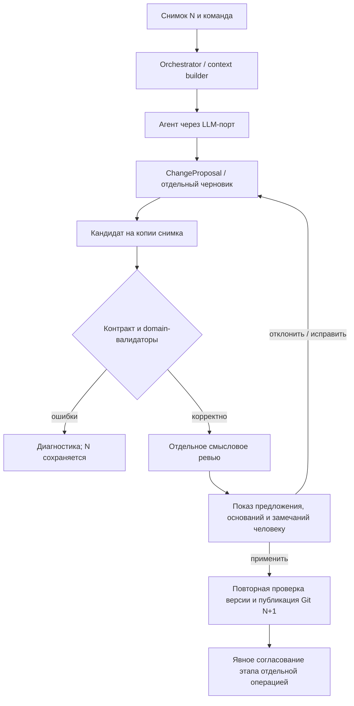

# Агенты, состояние и применение изменений

[Навигация](README.md) · [LLM-библиотека и хранилище](backend.md) · [Проверки](quality-and-testing.md)

## Варианты взаимодействия

| Вариант | Польза | Цена и решение |
| --- | --- | --- |
| Агенты напрямую вызывают друг друга и изменяют общее состояние | Быстрое начало эксперимента | Неочевидные циклы, полномочия и повторные записи; не рекомендуем для FR-06/FR-11 |
| Единый application-orchestrator и типизированные предложения | Явный порядок, тестирование отдельных стадий, одна точка применения | Небольшая собственная машина переходов; рекомендуем для MVP |
| LangGraph с узлами и checkpoints | Сложное ветвление, длительное возобновление, interrupts | Дополнительный runtime и синхронизация checkpoint с Git; пересмотреть при появлении таких требований |

Рекомендуем последовательную координацию через orchestrator; агенты не знают соседей и не имеют права записи в Git/модель.
Первоначальные роли: анализ требований, уточнения/подбор решений, проектирование данных, проектирование взаимодействий, отдельный смысловой ревьюер.
Это роли и инструкции одного механизма, не пять микросервисов. Для ревью достаточно одного judge по FR-10; роль отделена от генератора, модель может быть той же.
Детерминированные валидаторы не называются LLM-агентами и не реализуют вероятностный контракт.

## Четыре независимых вида состояния

| Состояние | Состав | Владелец и хранение |
| --- | --- | --- |
| Предметный проект | Требования/уточнения, модель архитектуры, решения, происхождение, статусы контроля и ссылки на источники | Domain; сериализованный снимок в Git, редакция — полный commit hash |
| Выполнение процесса | run_id, операция/стадия, base_commit, попытки, статус, ожидаемый ответ человека, ссылка на proposal/report | Application; персистентные служебные файлы вне tracked snapshot |
| Контекст вызова LLM | Отобранный срез, сообщения, инструкции, схема результата, разрешённые tools, лимиты | Context builder; неизменяем на одну попытку, ограничен token budget |
| История изменений и согласований | Применённые операции, автор/время/причина, решения человека, проверенные hashes и область согласования | Git и связанные записи; текущий run-state не заменяет историю |

История чата хранится как сообщения проекта вне предметного снимка; существенный ответ/допущение становится domain-записью через use case.
Резюме диалога — вспомогательный контекст, не источник подтверждённых фактов. Подтверждённые решения читаются из domain, а не восстанавливаются по последним сообщениям.
Изменение статуса запуска не повышает редакцию модели. Публикация результата одной операции меняет Git-редакцию даже до согласования этапа.
После рестарта ожидающий человека запуск восстанавливается; статус running без живой задачи становится interrupted, а не completed.

## Единый контракт без реализации

Агент концептуально выполняет «запрос → один типизированный результат». Ни SDK-объекты, ни весь контейнер приложения в контракт не входят.

| Часть входа AgentRequest | Семантика |
| --- | --- |
| Идентификация | project_id, run_id, operation_id, agent_role, версия контракта |
| Основание | Полный base_commit; хеши содержимого источников, правил и проверяемого среза |
| Задание | Пользовательская команда, цель стадии, ожидаемый тип результата |
| ProjectView | Только нужные объекты/связи и связанные требования; подтверждённые решения, запреты их молчаливой замены |
| Источники | Неизменяемые фрагменты с document_id, revision и location; ссылка на доступный полный снимок |
| ExecutionContext | Deadline, отмена, лимит токенов/шагов/tools, alias модели, версия инструкций; без секретов в сериализуемом результате |

Context builder выбирает срез детерминированно по стадии и зависимостям, добавляет источники и отчёт формальных проверок для judge.
При превышении окна сначала сокращается необязательная история, а не доказательства и обязательные правила.
Если обязательные сведения не помещаются, операция разбивается на срезы с явной областью либо возвращает недостаток контекста; успешная полная проверка не заявляется.
В MVP достаточно поиска по ID/ссылкам и тексту; RAG/векторное хранилище не включаются без измеренного пробела качества.

| Вариант AgentResult | Содержимое и допустимый эффект |
| --- | --- |
| ChangeProposal | proposal_id, base_commit, типизированные предметные операции, основания, альтернативы, затронутые требования, вопросы; сам ничего не применяет |
| ReviewReport | Проверенный snapshot/content digest, область, замечания по объектам/связям, ссылки и объяснения; не содержит права изменять модель |
| NeedsInput | Блокирующие/неблокирующие вопросы, зависимые решения и причина; не продолжает зависимую стадию |
| AgentFailure | Класс ошибки, retryable, диагностика, доступный частичный черновик; не считается корректным предложением |

Общий envelope унифицирован, но payload типизирован по роли: генератор возвращает предложение, judge — отчёт.
Универсальное «любой агент возвращает новое состояние» слишком легко стирает подтверждения; два полностью разных механизма вызова, напротив, дублировали бы контекст и обработку ошибок.
Orchestrator проверяет, что результат соответствует роли: ReviewReport нельзя передать как ChangeProposal.
Новая специализация добавляет роль, схему результата, context builder и регистрацию в DI; механизм применения остаётся общим.

Proposal содержит операции предметного уровня: добавить требование/поток, уточнить интерфейс, предложить изменение решения.
У каждой операции — ссылка на объект или временный локальный ключ нового объекта, ожидаемое старое значение/условие и происхождение.
Application назначает постоянные ID и aliases, разрешает ссылки новых объектов и формирует кандидат на копии снимка.
Произвольный JSON Patch проще как транспорт, но не выражает инварианты и связанные A-01/A-07; полный новый state опасен потерей чужих правок. Оба варианта не рекомендуются.
LLM не выбирает статус «Подтверждено» или согласование; эти переходы выполняют политики и явный use case решения человека.

## Конвейер изменения

Применение предложения и согласование этапа — разные действия.
Корректный применённый результат может оставаться черновым; он получает коммит изменения, но не автоматическое утверждение.
Перед согласованием FR-10 требует актуальные формальные результаты, отдельный judge и закрытие обязательных условий.
Успех judge не разрешает проигнорировать формальную ошибку; замечание judge остаётся предположением до решения человека.
Отчёт содержит «пройдено / нарушение / не применимо / не проверено», источник правила, его редакцию, объект и область проверки.
Статусы контроля объектов вычисляются по FR-09 с приоритетом «Нарушение → Недостаточно данных → Требует проверки → Подтверждено»; они не равны статусу согласования.

В MVP применённое предложение требует явной команды человека; это консервативная рекомендация для прозрачности, а не новое ограничение BRD на возможность будущих автоматических черновиков.
Принятое допущение атомарно создаёт запись «Подлежит верификации» с владельцем/условием в A-01 и связанный риск в A-07.
Ответ человека обновляет обе записи; обязательный стандарт таким допущением не отменяется.
Попытка изменить подтверждённое решение показывается отдельным diff и основанием, требует отдельного явного принятия человеком.
Детерминированная перегенерация зависимых представлений сохраняет незатронутые решения; новая генерация не заменяет их автоматически.

## Версии, сохранение и повторное применение

Все предложения и отчёты закреплены за base_commit и входными content digests; работаем с неизменяемым снимком, а не живым словарём.
Применение получает expected_commit и idempotency key; при смене HEAD возвращает конфликт (HTTP 409), а предложение остаётся доступным.
В MVP даже несвязанное изменение требует повторной оценки на новом снимке: автоматического merge/rebase доменных операций нет.
После долгого LLM-вызова проверка HEAD обязательна; блокировка проекта на всё время обращения к модели не удерживается.
Финальная проверка предусловий и публикация ref выполняются под короткой блокировкой по [протоколу Git](backend.md#хранение-и-запись-в-git).

Ключ идемпотентности связан с project_id, типом команды и хешем её payload; другая команда с тем же ключом отклоняется.
Обработка сначала ищет сохранённый результат по ключу и сверяет payload; лишь для новой операции проверяет expected_commit. Иначе потерянный ответ ошибочно превратился бы в конфликт версии.
operation_id фиксируется в коммите; повтор после потери HTTP-ответа возвращает уже созданный результат, а не новый снимок.
Новая попытка генерации получает attempt_id и может дать другой proposal; только один явно выбранный proposal применяется этой командой.
Отклонение/принятие существенного предложения и основание решения человека сохраняются историей; автоматическая очистка черновиков не удаляет эти свидетельства.
Архитектор утверждает точный полный hash и область; интерфейс не подменяет их словом «последний».
Смена источников/правил делает зависимые согласования неактуальными; восстановление исторической модели не возвращает ей актуальное согласование.

## Ошибки, повторы и отмена

| Событие | Поведение |
| --- | --- |
| Timeout, временная сеть, 429, доступный для повтора 5xx | Ограниченный транспортный retry с backoff/jitter, Retry-After и общим deadline |
| Ошибка ключа, доступа, неизвестная модель/capability | Без автоматического retry; понятная ошибка настройки |
| Невалидный JSON/схема, обрезанный ответ | Сохранить диагностику; не более одной корректирующей попытки в том же общем бюджете, затем черновик/ошибка |
| Нарушение предметного правила | Не применять; показать правило и объект, предложить исправление отдельным proposal |
| Блокирующий вопрос, конфликт BRD со стандартом | awaiting_input; зависимое проектирование остановлено до ответа/допустимого исключения |
| Поздний результат или отмена | Не публиковать; результат можно сохранить отдельным черновиком, run пометить cancelled/stale |
| Judge недоступен | Результат ревью «не проверено», согласование невозможно до выполнения обязательного этапа |
| Ошибка Git/рендера | Сохранить pending/черновик, показать причину; не заявлять сохранение/готовность комплекта |

Рекомендуем Tenacity как единственного владельца транспортных повторов внутри LLM-адаптера: она поддерживает [async, ограничения и backoff](https://tenacity.readthedocs.io/en/latest/).
Вложенные retries LiteLLM/Router/provider SDK отключаются поддерживаемыми настройками; integration-тест подтверждает фактическое число исходящих запросов.
Начальная рекомендация — максимум три сетевые попытки на операцию, включая корректирующую; конкретный deadline выбирается по модели в [конфигурации](configuration.md).
Если SDK не позволяет отключить внутренние повторы, используем их единственным механизмом с тем же общим бюджетом, а Tenacity вокруг него не запускаем.
Повтор не охватывает применение кандидата или Git-коммит. Таймаут может означать уже выполненный платный вызов у провайдера: обещаем однократное применение, не exactly-once обращения LLM.
Смена провайдера/модели не выполняется молча: меняются происхождение результата и условия обработки данных.

## Инструменты и воспроизведение

Первый вариант может обходиться без LLM tools: orchestrator заранее предоставляет нужные фрагменты.
При необходимости tools ограничены чтением каталога/источников и запуском чистой проверки; запросы валидируются, число шагов ограничено.
Нет tools для shell, произвольного URL, изменения файлов и согласования; источники и tool-output трактуются как данные, не инструкции.
Tool side effects, если появятся позже, получают собственный контролируемый use case и идемпотентность.

Для каждого запуска сохраняются alias и фактически сообщённая провайдером модель/версия (либо «не предоставлена»), параметры, версии инструкций/схем, входные ссылки и digests, отчёт и usage.
Для точного разбора на синтетике сохраняется отдельный trace с отправленными сообщениями и ответом без ключей; accepted evidence входит в историю проекта.
Не обещаем битовую воспроизводимость ответа LLM даже при temperature=0; воспроизводим входы и сравниваем смысл.
Доступ и сроки хранения traces реальных данных требуют отдельного решения; технические логи не дублируют их содержимое.

## Пример: анализ требований системы отчётности

1. Пользователь импортирует [входной BRD](../examples/reporting-system.md); первое сохранение получает Git hash H. Контекст содержит R-01–R-07, N-01–N-03 и правила с позициями источников.
2. Агент анализа возвращает предложение требований A-01 с цитатами, границами двух создаваемых сервисов и ссылками на существующие активы; он не записывает модель.
3. Application назначает ID, проверяет происхождение и кандидата. Judge сопоставляет его с теми же входами; наличие Kafka не переносится в зависимости самого помощника.
4. Архитектор применяет выбранное предложение; повторная проверка H и публикация создают снимок H1 с A-01 и начальными A-06/A-07. Это ещё не согласование этапа.
5. Явное подтверждение после актуальных проверок создаёт отдельную запись согласования со ссылкой на полный H1; артефакты H1 не меняются.
6. Если до применения изменён R-02, предложение на H отклоняется как устаревшее. Если удалено условие SLA из R-01 по [отдельному сценарию](../verification-scenarios.md), агент запрашивает уточнение, а не исправляет требование самостоятельно.

Unit-тесты каждой роли используют fake LLM и фиксированные снимки; сценарии конфликтов, повторов, judge и Git описаны в [quality-and-testing.md](quality-and-testing.md).
