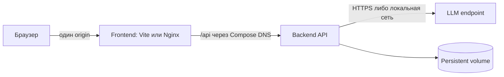

# Docker и развёртывание

[Навигация](README.md) · [Настройки и секреты](configuration.md) · [Хранение](backend.md#хранение-и-запись-в-git)

## Минимальный состав

Рекомендация — Docker Compose для локального однопользовательского запуска и два постоянно работающих контейнера.
У каждого приложения собственная сборка и lifecycle; один репозиторий исходников не означает один исполняемый процесс.

| Компонент | Содержимое и ответственность | Постоянные данные |
| --- | --- | --- |
| Backend | Python runtime, FastAPI, зависимости, Git CLI, локальный PlantUML CLI, JRE/Graphviz и кириллические шрифты | Один локальный persistent volume: Git-проекты, снимки источников, черновики, chat/run-state, pending journal |
| Frontend | Development: Node/Vite; production: собранная SPA и Nginx | Нет; статические файлы поставляются в образе |
| LLM endpoint | Внешний API либо локальный Ollama/совместимый сервер по выбранному профилю | Вне базового Compose; веса и GPU зависят от выбранной модели |

Локальный рендерер внутри backend устраняет внешний PlantUML API и третий сервис; цена — больший образ и JRE.
Отдельный renderer-container оправдан при измеренной потребности изоляции/масштабирования; сейчас его жизненный цикл проще ограничить subprocess с timeout и ресурсными пределами.
Redis, PostgreSQL, Kafka, LiteLLM Proxy и отдельный worker не включаются в базовый Compose: текущие требования их не обосновывают.
Использование Kafka/PostgreSQL в [синтетическом примере](../examples/reporting-system.md) не требует запускать их для анализа этого примера.

## Сеть frontend/backend

Браузер использует относительный `/api`; имена `backend` и `ollama` из Compose ему недоступны.
В development Vite proxy перенаправляет `/api` на backend по имени сервиса; в production то же делает Nginx, сохраняя API-префикс по согласованному правилу маршрутизации.
Nginx отдаёт index.html для UI deep links, но API-ошибка не превращается в HTML со статусом 200.
Порты разработки публикуются только на loopback хоста; backend внутри сети слушает контейнерный интерфейс.
При отдельном локальном frontend вне Compose разрешается только явный dev CORS origin; wildcard с credentials не используется.
Production — HTTPS на входном proxy, закрытый прямой backend port и same-origin без отдельного CORS.
Будущий SSE потребует timeout и отключения proxy buffering; для начального polling специальных WebSocket-настроек нет.

## Development и production

| Область | Development | Production |
| --- | --- | --- |
| Исходники | Bind mounts только каталогов кода, hot reload | Неизменяемые образы, без source mounts и reload |
| Frontend | Node/Vite dev server | Multi-stage build, статические файлы и Nginx; Node runtime не нужен |
| Backend | Dev-инструменты доступны в development target | Только runtime-зависимости; один process/worker по принятой файловой модели |
| Конфигурация | Локальные env overrides и YAML | Явно смонтированный несекретный YAML, env, secret files; dotenv не читаются |
| Данные | Отдельный dev volume с синтетикой | Сохраняемый volume с ограниченными правами и резервированием |
| Логи | Читаемый локальный формат по необходимости | JSON в stdout, redaction; traces хранятся отдельно |

Образы собираются воспроизводимо по lock-файлам; версии базовых images фиксируются при реализации с политикой обновления безопасности.
Backend/рендерер работают непривилегированным пользователем; запись разрешена только в data/temp.
Volume не монтируется поверх кода. Git-репозитории создаёт приложение, сторонние hooks/произвольные команды пользователя не запускаются.
PlantUML получает только сгенерированный код с экранированными названиями, а не .puml от LLM/пользователя.
Выбирается [профиль безопасности PlantUML](https://plantuml.com/security) без сетевых includes; локальная ArchiMate-библиотека поставляется вместе с рендерером и разрешается только при необходимости.
Совместимость выбранного security profile с bundled include из эталона проверяется в PR рендеринга; автоматическое ослабление до LEGACY не допускается.
SVG отдаётся как изображение с ограничениями content policy; выполнение активного содержимого в контексте UI не требуется.

## Конфигурация контейнеров

Порядок источников внутри backend определён только в [configuration.md](configuration.md#приоритет-загрузки).
Compose `.env` подставляет переменные в Compose-модель и сам по себе не передаёт их процессу контейнера.
`environment`/`env_file` задают окружение контейнера; источники не смешиваются неявно с собственным dotenv loader приложения.
Для development рекомендуем передавать явно выбранные env-файлы контейнеру, а чтение dotenv внутри него выключать; вне Docker действуют `.env` → `.env.local` с приоритетом окружения процесса.
В production разрешены только нужные поля; backend secret mounts не доступны frontend, build secrets не используются как runtime-настройки.
[Compose secrets](https://docs.docker.com/compose/how-tos/use-secrets/) выдаются конкретному сервису через `/run/secrets`, исходные файлы и резервные копии защищаются на хосте.

## Локальные LLM

По умолчанию backend подключается к настроенному endpoint; локальную модель не требуется скачивать каждому пользователю облачного профиля.
Ollama на хосте доступен по адресу хоста из контейнера, а не `localhost` контейнера; для Linux механизм host gateway задаётся явно.
Альтернатива — необязательный Compose profile локального LLM с модельным volume; требования к RAM/GPU и health check определяются после выбора модели.
Endpoints не публикуются в интернет. Встроенный Docker DNS используется для контейнерного LLM, host gateway — только для хостового.
Offline-проверки с fake LLM не запускают Ollama и не требуют ключей; реальная локальная модель проходит отдельный capability/quality smoke-test.
Переключение на облачного провайдера при сбое локального не выполняется автоматически, поскольку меняет место обработки данных.

## Health checks, запуск и остановка

Backend liveness сообщает, что процесс отвечает; readiness проверяет валидность настроек, состояние хранилища/Git и отсутствие неразрешённого recovery.
Диагностика рендерера выполняется при старте; простой health check не запускает JVM и платный LLM-вызов каждый раз.
Недоступность LLM показывается отдельно как degraded и не скрывает сохранённую историю/редактирование; согласование без обязательного judge остаётся заблокировано.
Frontend health check проверяет static response; завершение задачи Git/рендера проверяется по статусу операции, а не по живому HTTP-порту.
[Compose запускает зависимости по порядку, но не ждёт готовности без `service_healthy`](https://docs.docker.com/compose/how-tos/startup-order/).
Для frontend допустим запуск после backend readiness; proxy использует повторное разрешение имени/ограниченный retry, restart backend не требует ручной пересборки SPA.
Опциональный локальный LLM при соответствующем profile имеет собственный health check; загрузка весов не маскируется как мгновенная готовность API.
При shutdown прекращается приём новых операций, завершается короткая Git-публикация, незавершённые LLM-runs сохраняются как interrupted; используется конечный grace period.

## Сохранность и границы эксплуатации

Git хранит историю, но не является резервной копией диска. Копируется весь data volume, включая .git, источники, черновики и pending journal.
Для согласованной резервной копии запись приостанавливается или применяется согласованный snapshot файловой системы; восстановление испытывается на отдельном каталоге.
Секреты не входят в проекты; LLM traces могут содержать данные источников и требуют тех же правил доступа, что и исходники.
Сроки хранения, RPO/RTO и расписание backup должны быть согласованы для самого помощника; N-02 системы отчётности на него автоматически не переносится.
Базовый Compose предназначен для локальной работы. Выставление в сеть требует согласованных аутентификации, авторизации и правил обработки данных, которые BRD пока не задаёт.
Production на одном хосте возможен после этих решений; Kubernetes и горизонтальное масштабирование не являются целью текущего MVP.
Dockerfile и Compose-файлы появятся в будущих PR по [плану реализации](implementation-plan.md), здесь описана только целевая организация.
