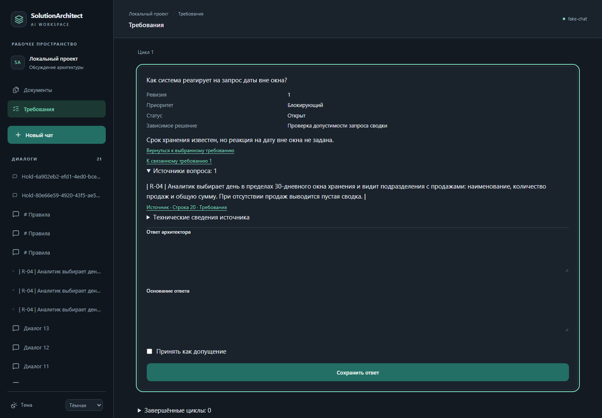
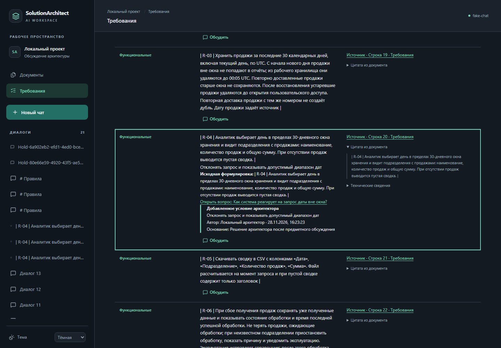

# PR 20: повторная приёмка этапа 3

Проверенная исходная ревизия: `269626a7d3b88293624a419e3ff56983429b9d66`.
Перед работой удалённая ветка проверена повторно: дополнительных коммитов не было.
Изменения продолжают [PR #20](https://github.com/Volodya1000/SolutionArchitectAI/pull/20),
ветку `codex/pr3-clarifications`. Сдаваемый SHA и результаты GitHub Actions
указываются в описании этого PR. Merge выполняет Володя.

Статусы ниже различают реализацию и уровень подтверждения. Контролируемая модель
проверяет механизм, но не подтверждает семантическое качество реальной Qwen.
Этапы 4A/4B, проектирование архитектуры и мобильный редизайн не реализуются.

## Замечания и проверяемые изменения

The testing-quality follow-up from baseline `75ad38f` is documented in
[PR20 test quality verification](pr20-test-quality.md). Existing closed items keep
their original evidence and scope; the failed real-Qwen acceptance remains open.

Все строки относятся к PR #20 и ревизии кода, содержащей этот отчёт.

| Пункт / дефект | Изменение | Тест или измерение | Состояние |
| --- | --- | --- | --- |
| A: повреждённая привязка останавливает TaskGroup | Ожидаемый `StoredDataCorrupt` завершает только чат с `stored_data_corrupt`; неизвестные ошибки не скрыты | PostgreSQL/HTTP: `test_worker_job_isolation.py`; соседний чат и независимое извлечение | Реализован; целевые тесты пройдены |
| A: SQLSTATE 40P01/40001 при claim останавливают очередь | Tenacity повторяет целую транзакцию после rollback, максимум 3 попытки; LLM вне повторяемой транзакции; исчерпание одного recovery не задерживает соседа | Оба SQLSTATE через worker/PostgreSQL; `test_transaction_runner.py`, `test_worker_retry.py`: предел, отмена, неизвестный SQLSTATE | Реализован; целевые тесты пройдены |
| A: readiness остаётся успешной без worker | Проверка обязательных task вместе с доступностью БД | HTTP 503 `required_worker_unavailable` при завершённом обработчике | Реализован; целевой тест пройден |
| B: test image не содержит helpers/tools | Только test target копирует `backend/test_helpers`, `tools` и конфигурацию import-linter, рабочая папка `/app` | Сборка без bind mount; collect-only и 4 import-контракта | Реализован; финальная сборка проверяется отдельно ниже |
| 1: одинаковый gap теряет первое окно | Детерминированное объединение связей, источников, причин, отпечатков и ревизий; повтор окна идемпотентен | `test_pr20_question_merge.py`: A→B, B→A, A→B→A; PostgreSQL: ответ обоим требованиям, третье не изменяется | Реализован; контролируемая модель + PostgreSQL |
| 2: пустой список стирает обязательный конфликт | Независимая оценка candidate/confirmed/refuted с проверенными источниками; финализация учитывает установленный конфликт | `test_pr20_known_conflict.py`, `test_pr20_conflict_recovery.py`; отдельный ложный кандидат опровергается источником | Реализован; контролируемая модель + PostgreSQL |
| 2: подтверждение допущения создаёт тупик | Новая ревизия допускает фактический ответ в том же run, сохраняются прежнее решение, риск и причина | Старое тупиковое состояние, повтор команд, confirm/reject/answer/resume; `mandatory-conflict.spec.ts` | Реализован; backend проверен, desktop результат указан ниже |
| 3: Markdown-разделитель становится требованием | markdown-it table tokens и карты физических строк; фильтрация во всех смысловых контекстах, перенос заголовка | `test_pr20_parser_acceptance.py`; TXT, fenced code, escaped pipe, пустая ячейка, строки 48/49/50, старые ссылки | Реализован; [отчёт парсеров](evidence/pr20-parsers.md) |
| 4: пропущенная DOCX-ячейка сдвигает колонки | python-docx grid offsets и expanded merged grid | Пропущенная первая ячейка, колонки 2/3, заголовок/локатор, объединения, сохранённый SourceRef | Реализован; [отчёт парсеров](evidence/pr20-parsers.md) |
| 5: история и run теряются в маршрутах | Канонический ID истории, поддержка старых команд, отдельный выбор истории, сохранение run на версиях/рисках, восстановление operation | PostgreSQL `test_browser_queries.py`; Vitest; `pr20-desktop-navigation.spec.ts` | Реализован; итоговый desktop результат ниже |
| 6 / 7а: коррекция без причины, смешанный язык инструкций | Различение JSON/schema/evidence, безопасные пути полей, английские системные сообщения, конкретные правила языка у агента | `test_structured_adapter.py`: реальные HTTP payload RU/EN для четырёх фаз и двух режимов; бюджет/отмена/дубликаты/NaN/refusal/truncation | Реализован; адаптерные и unit-регрессии |
| 7б: внутренние UUID/SHA и выдуманные ссылки | Вход извлечения f0, предметный чат f/r/q/d/k; сервер сопоставляет и строит URL, неизвестные метки и посторонние URL не активируются | Перехваченный HTTP адаптера; два документа с одинаковым текстом; chunk boundaries; verified/unverified и причина | Реализован; PostgreSQL/адаптер + unit |
| 7а: старое clarify-3 считается актуальным | Сохранённые и текущие версии восьми влияющих контрактов/промптов; старые неизвестные значения null | Старые строки без metadata/clarification, смена clarify/review/assessment; UI показывает изменившиеся версии | Реализован; PostgreSQL + Vitest |
| 8: restart повторяет CLARIFY | PostgreSQL-кэш валидированных окон и отдельных вердиктов, ключ включает run/phase/input/profile/instructions | `test_pr20_durable_review.py`: сбой после отдельных commit и до финального save, новый worker без новых вызовов/списаний | Реализован; [граница гарантии](evidence/pr20-durable-review-conflicts.md) |
| 9: полные SQL-чтения и скрытые зависимости | Lookup части по ключу, SQL-прогресс, пакетные вопросы/ревизии/решения/риски, условный polling + межвкладочное обновление, прямой Dishka DI | 20 вопросов: 84→6 SQL; сохранение после 10 частей: 13→2 возвращённых строк; [измерения](evidence/pr20-sql-loading.md) | Реализован; PostgreSQL и frontend проверки |
| 9: ранний пустой список уточнений оставался в UI | Однократное обновление при смене компактного статуса, отмена устаревшего запроса; периодический полный polling только для resume_pending | `run-result-refresh.test.tsx`: 7 регрессий; поздний старый ответ, отсутствие периодических чтений, межвкладочное обновление | Реализован; тесты и повторный desktop прогон |
| 10: ручные HTTP-контракты расходятся | Автономный app.openapi(), закреплённый @hey-api/openapi-ts 0.99.0, сгенерированные TS/Zod на границе unknown JSON, drift в CI | `api:generate`, `api:check`, повтор без diff, реальная смена backend-поля вызывает отказ до регенерации; UUID/date/nullable/union | Реализован; [подробности](evidence/pr20-api-contracts.md) |
| 11: выбор PDF-парсера без измерений | Отдельный pypdf/Docling эксперимент без изменения runtime | Оба исходных PDF; example p2 R-04: строка, ячейка, заголовок, bbox, точная цитата и несовместимость старых фрагментов | Выполнен; [измерения и решение](evidence/pr20-pdf-parser-comparison.md) |
| Остаточные чтения | Пустая привязка отклоняется до решения, corrupt operation даёт JSON `stored_extraction_corrupt`, неполный вопрос изолируется | Реальная PostgreSQL: `test_stored_sql_json.py`, `test_browser_queries.py`; HTTP-вход сохраняет обычную валидацию | Реализован; [результаты](evidence/pr20-data-packaging.md) |
| Разбиение с одной записью истории | Дополнительное разбиение источников/требований с повтором нужной истории, измерение окончательных сообщений | `test_pr20_history_window_splitting.py`: делимый вход помещается, история/источники полны, неделимый отклоняется | Реализован; [результаты](evidence/pr20-history-window-splitting.md) |
| Производные метаданные парсинга | Сохранённый structure не считается доверенным: Markdown выводится из проверенных байтов, другие MIME не наследуют table metadata | `test_document_structure_integrity.py`: 9 passed; сохранённые IDs/digest/locators, свежий parse переиспользуется | Реализован; [регрессия](evidence/pr20-parser-metadata-integrity.md) |
| Реальная Qwen | Шесть независимых входов, три предметных ответа, HTTP payload, restart и открытие ссылки | Большие BRD отказали на извлечении; английская пара дала неверные вопросы; предметный чат пропуск не объяснил | Частично реализована проверка; **семантическая приёмка не пройдена**, [факты и открытые критерии](evidence/pr20-real-qwen-2026-11-28.md) |

## Совместимость и ограничения

Сохранены публичные маршруты, идентичность документов и физических фрагментов,
старые SourceRef, исходные байты/SHA, исторические результаты и thread_id.
Дополнительные поля имеют совместимые значения по умолчанию. Миграции 0008/0009
добавляют кэш и оценки конфликтов; прежние решения и риски не перезаписываются.
`SqlAlchemyStoreContext` сохраняет разделение недоступности, integrity и остальных
SQL-ошибок; `SqlStoreErrorPolicy` не возвращён. Рабочая команда import-linter
документирована из корня репозитория.
Черновики сравнивают значения ID версии и SHA независимо от порядка JSON-полей:
сгенерированная Zod-схема при чтении не делает прежний черновик устаревшим.
Изменение версии или SHA по-прежнему требует явного переноса. Регрессия сначала
падала, после исправления все 11 тестов уточнений прошли.

Гарантия отсутствия повторного LLM-вызова действует после локального SQL commit
валидированного результата. Сбой между внешним ответом и commit может повторить
запрос: exactly-once внешнего endpoint не обещается. SQL-агрегат прогресса ещё
читает старый JSON внутри PostgreSQL, но не переносит все кандидаты в Python.
Docling даёт лучшую целостность проверенных таблиц, но дороже и не совместим
побайтово с прежними фрагментами; основной runtime остаётся на pypdf.

## Интегрированная проверка

Собственные проверки на Windows, Python 3.13.9, Node 26.13.1, pnpm 12.21.0:

| Проверка | Фактический результат |
| --- | --- |
| `tools.quality fast` | passed; 409 Python passed: 398 unit и 11 быстрых quality probes, без skips |
| Все quality probes | 42 passed, без skips; 11 из них входят также в fast, числа не складываются |
| PostgreSQL и реальные HTTP-адаптеры с управляемым ответом | 305 passed / 305 collected / 0 skipped; backend coverage 94.63% |
| Последний Vitest после исправления status refresh | 121 passed / 20 файлов / 0 skipped; coverage statements/branches/functions/lines 92.79/86.02/90.93/94.29% |
| Playwright на Compose с fake | 35 passed / 0 skipped, включая пять новых desktop-сценариев; 3.4 минуты |
| `tools.quality full` | passed: статические/архитектурные проверки, сборка, оба аудита, PostgreSQL, Playwright и runtime smoke |
| Runtime smoke | passed: SSE disconnect, cancellation, graceful shutdown, abrupt restart, PostgreSQL restart/outage, изоляция истории |
| Docker test target без bind mount | built; **745 collected**, не 745 passed; 4 import-контракта kept, 0 broken |
| OpenAPI/Zod | `api:check` passed; повторная генерация совпадает с автономной схемой |

`pre-commit fast` и `pre-push full` не отключаются; их результат и GitHub Actions
привязаны к сдаваемому SHA в описании PR. Состояние внешнего CI проверяется после
публикации, отдельно от перечисленных собственных прогонов.

В промежуточных прогонах обнаружены и исправлены: три high advisory
транзитивного `js-yaml 4.2.0` нового генератора; сравнение черновиков по порядку
JSON-полей; устаревшая UUID-фикстура; ранний пустой UI-кэш; общий task backlog
в новом тесте продолжения. Аудит исправлен адресным закреплением 4.3.2,
без снижения уровня проверки. [Advisory и исправленная версия](https://github.com/advisories/GHSA-2883-xcg3-v3hh).
Последующий полный прогон прошёл. Предупреждение Vite о bundle больше 500 kB
сохраняется; сборка успешна.

## Реальная модель

Реальная приёмка выделена отдельно от fake и PostgreSQL с управляемым ответом.
[Обезличенный отчёт Qwen](evidence/pr20-real-qwen-2026-11-28.md) и
[полные фактические сообщения/ответы](evidence/pr20-real-qwen-2026-11-28.json)
фиксируют модель, профиль, версии, расход запросов, время, найденные вопросы,
перепроверку, пропуски и ложные блокировки. Восемь первичных payload извлечения
дополнительно воспроизведены текущим кодом и совпали с перехватом.

Большие BRD не дошли до CLARIFY: полный — `truncated_response`, неполный —
`schema_invalid` после перевода нормализации на английский и исчерпания двух
общих коррекций. Русские перефразы также отказали на языке. Английские входы
дошли до `clarify-4`, но вместо нужной реакции вне интервала получили вопросы
о хранении сверх уже указанного срока; перепроверка их сохранила.
Qwen в трёх предметных ответах не назвала недостающее поведение. Реальная
ссылка R-03 открыта после restart; ссылки R-04 ведут к выбранному требованию.
Настоящий вопрос в больших BRD не появился, поэтому сохранение одного ответа
через карточку и resume на Qwen остаются незакрытыми. Вопрос не подставлялся.

## Desktop-скриншоты

Оба снимка относятся к одному требованию и одному вопросу в проверке с fake,
1440×1000. Они подтверждают UI и сохранение данных, а не качество Qwen.

